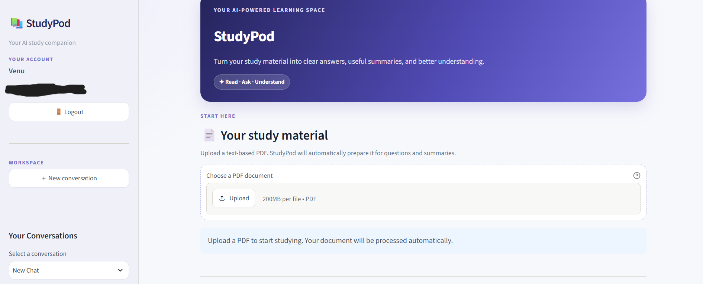
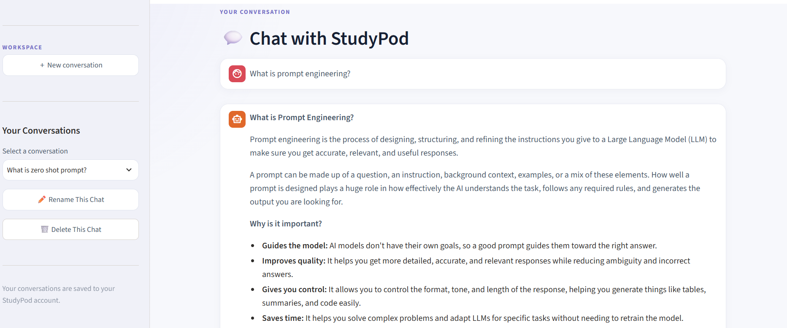
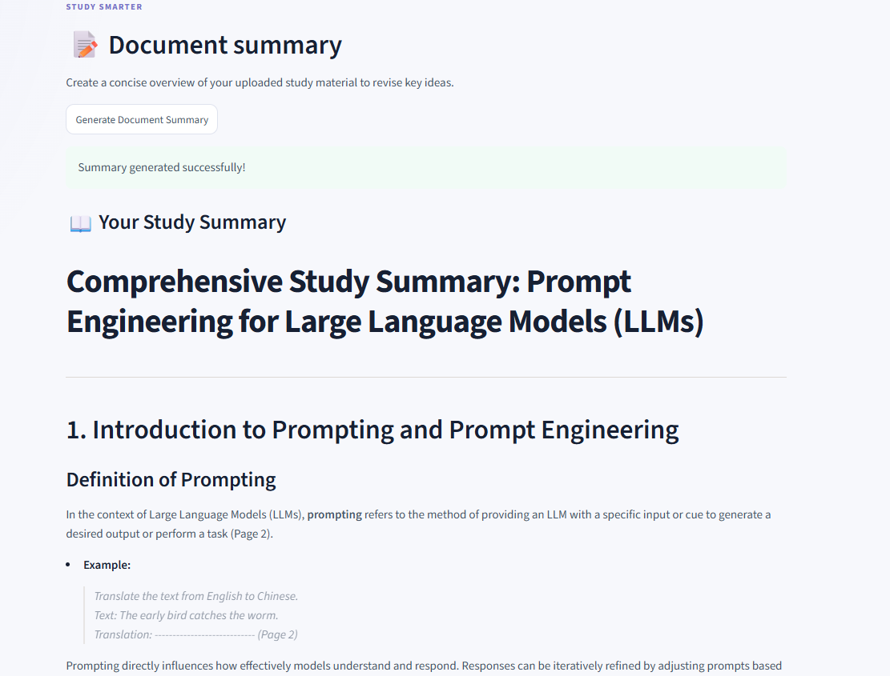

# StudyPod – AI-Powered PDF Study Assistant

StudyPod is an AI-powered PDF study assistant that helps students understand and interact with their study materials. It uses Retrieval-Augmented Generation (RAG) to retrieve relevant information from uploaded PDF documents and generate contextual answers using Google's Gemini API.

Users can upload documents, ask questions, generate summaries, and maintain multiple persistent conversations.

**Live Application:** https://studypod-ai.streamlit.app/

## Features

- **PDF Upload:** Upload PDF documents and extract their text.
- **Intelligent Question Answering:** Ask questions and receive context-aware answers based on uploaded documents.
- **Semantic Search:** Retrieve relevant document passages using Sentence Transformers and FAISS.
- **Passage Reranking:** Improve retrieval relevance using a CrossEncoder model.
- **AI-Powered Responses:** Generate student-friendly answers using Google Gemini.
- **Document Summarization:** Generate structured summaries of uploaded PDFs.
- **Conversation Management:** Create, rename, switch between, and delete conversations.
- **Chat History:** Maintain persistent conversation history.
- **Source References:** View retrieved passages and their PDF page references.
- **User Authentication:** Secure registration and login with bcrypt password hashing.
- **Multi-User Support:** Maintain separate conversations and documents for different users.
- **Persistent PDF Storage:** Store uploaded PDFs using MongoDB GridFS and restore them across sessions.

## Application Screenshots

### Dashboard


### Question Answering


### Document Summary



## Technology Stack

| Category | Technologies |
|---|---|
| Frontend / UI | Streamlit |
| Programming Language | Python |
| PDF Processing | PyMuPDF |
| Embeddings | Sentence Transformers (`all-MiniLM-L6-v2`) |
| Vector Database | FAISS |
| Reranking | CrossEncoder |
| Generative AI | Google Gemini API |
| Database | MongoDB Atlas |
| File Storage | MongoDB GridFS |
| Authentication | bcrypt |
| Deployment | Streamlit Community Cloud |
| Version Control | Git and GitHub |

## System Architecture

1. **Document Processing:** Extract text and page information from uploaded PDFs using PyMuPDF.
2. **Text Chunking:** Split extracted text into manageable, paragraph-aware chunks.
3. **Embedding Generation:** Convert text chunks into numerical embeddings using Sentence Transformers.
4. **Vector Indexing:** Store embeddings in a FAISS index for efficient similarity search.
5. **Retrieval:** Retrieve relevant passages based on the student's question.
6. **Reranking:** Reorder retrieved passages using a CrossEncoder model.
7. **Answer Generation:** Pass relevant context and conversation history to Gemini to generate an answer.
8. **Persistence:** Store user accounts, conversations and PDF files in MongoDB Atlas.

## Project Structure

```text
StudyPod/
│
├── app.py
├── evaluate_retrieval.py
├── evaluation_questions.json
├── requirements.txt
├── .gitignore
│
├── core/
│   ├── __init__.py
│   ├── auth.py
│   ├── database.py
│   ├── chat_storage.py
│   ├── pdf_storage.py
│   ├── pdf_processor.py
│   ├── text_chunker.py
│   ├── vector_store.py
│   └── answer_generator.py
│
└── test_*.py
```

## Installation and Setup

### 1. Clone the repository

```bash
git clone https://github.com/VenuInsights/StudyPod.git
cd StudyPod
```

### 2. Create a virtual environment

```bash
python -m venv .venv
```

Activate it on Windows:

```bash
.venv\Scripts\activate
```

### 3. Install dependencies

```bash
pip install -r requirements.txt
```

### 4. Configure environment variables

Create a `.env` file in the project root:

```env
GEMINI_API_KEY=your_gemini_api_key
MONGODB_URI=your_mongodb_connection_string
```

Never commit your `.env` file or expose your credentials.

### 5. Run the application

```bash
streamlit run app.py
```

## Deployment

StudyPod is deployed using Streamlit Community Cloud.

The deployed application uses Streamlit Secrets to securely configure:

- `GEMINI_API_KEY`
- `MONGODB_URI`

MongoDB Atlas provides persistent storage for user accounts, conversations and uploaded PDF documents.

## Future Enhancements

- Voice-based question answering.
- Improved retrieval evaluation and optimization.
- Additional document formats.
- More advanced personalization and study assistance features.

## Author

Developed as an AI-powered document learning and study assistance project.

**Live Demo:** https://studypod-ai.streamlit.app/